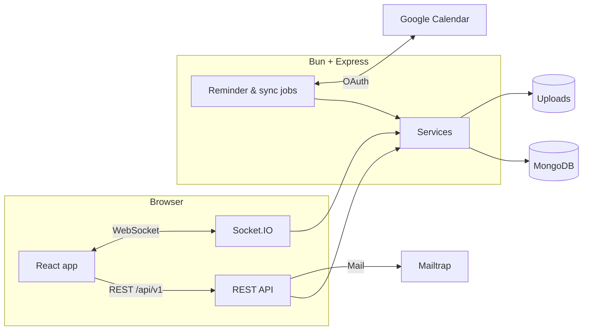

# Team Task

**A real-time workspace for teams: tasks, chat, notes and calendar in one app.**
Think ClickUp's task views, Slack's chat, Notion's pages and Notion Calendar's scheduling, sharing one account, one theme and live updates everywhere.

This repository is the **web app** (React + TypeScript). The API lives in [team-task_backend](https://github.com/Ernie1234/team-task_backend).

> Live demo: _coming soon_ · Author: [Anumah Joshua Eneye (Ernie)](https://ernie-portfolio.vercel.app) · [LinkedIn](https://linkedin.com/in/anumahjoshua) · [GitHub](https://github.com/Ernie1234)

---

## Features

Everything below is built and working. Unticked items are on the [roadmap](#roadmap).

### Workspaces, projects and people
- [x] Multiple workspaces per user, with a switcher and a Notion-style account menu
- [x] Role-based access: Owner, Admin and Member with fine-grained permissions
- [x] Invite people by link or by email; change roles and remove members
- [x] Projects with emoji icons, per-project task stats and a project chat channel
- [x] Workspace activity feed

### Tasks (ClickUp-style)
- [x] List view grouped by status, with inline editing of status, priority, assignee and due date
- [x] Board view with drag-and-drop between status columns
- [x] Subtasks with progress, expandable inline and in the task panel
- [x] Rich task descriptions: slash commands, checklists and headings, saved as Markdown
- [x] Search, filters (status, priority, assignee, project), quick filters (Mine, Overdue, Today, This week) and sorting, all kept in the URL
- [x] Optimistic updates with rollback, and live updates when teammates change tasks

### Dashboard
- [x] Personal greeting and summary, with KPI cards that open pre-filtered task lists
- [x] "My work" grouped into Overdue, Today, Next 7 days and Later
- [x] 14-day completion trend, status and priority breakdown, team workload
- [x] Chat activity and recent activity widgets

### Chat (Slack / Messenger-style)
- [x] Workspace channel, project channels and direct messages
- [x] Live presence (online / last seen) and typing indicators
- [x] Replies, reactions, edit and delete, jumbo emoji
- [x] Image and file uploads with a shared-files panel
- [x] Unread counts and read state, with optimistic sending and retry

### Notes (Notion-style)
- [x] Pages with an icon, title and block editor: `/` commands, Markdown shortcuts, a formatting toolbar and drag handles
- [x] To-dos, toggles, quotes, code blocks, tables and images
- [x] Nested sub-pages, page tree with search, breadcrumbs
- [x] Private or shared with the workspace; autosave with save status
- [x] Edit together in real time: live cursors with names, avatars of who's on the page, keeps working offline and merges on reconnect
- [x] Templates: meeting notes, to-do list, project brief, daily journal

### Calendar (Notion Calendar-style)
- [x] Week (time grid), month and agenda views, with task due dates shown alongside events
- [x] Create and edit events: all-day or timed, location, description, reminder
- [x] Two-way Google Calendar sync over OAuth: Google events appear here, and events created here are added to Google
- [x] Reminders: in-app toast with Join / Snooze, a notification entry, and desktop alerts
- [x] "Upcoming events" in the sidebar

### Notifications
- [x] Bell menu with unread count, plus a full notifications page
- [x] Real-time delivery over WebSockets, mark as read / mark all as read

### Settings, account and personalisation
- [x] Notion-style Settings window (Ctrl + ,)
- [x] Account: profile name and photo, add or change password, signed-in devices with log out of one or all, delete account
- [x] Appearance (Slack-style): light / dark / system, 10 colour themes plus custom colours, coloured sidebar, corner style
- [x] Font & text: 11 fonts (including two easier-to-read fonts), text size, reduce motion
- [x] Preferences sync to your account across devices

### Sign-in (Better Auth)
- [x] Stay signed in for 30 days; the session renews while you use the app
- [x] Email and password with a 6-digit email code (resend with cooldown)
- [x] Sign in with Google (links to an existing account with the same email)
- [x] Forgot password: reset with an emailed code, then signed straight in

---

## Roadmap

Ticked off as each item ships.

### Production-grade engineering
- [ ] Deploy (web on Vercel, API on Fly.io / Render) with a seeded demo account and a "Try the demo" button
- [x] Persistent sessions in MongoDB with Better Auth (sign-ins survive restarts)
- [ ] Socket.IO Redis adapter (chat, presence and reminders across several server instances)
- [ ] File uploads on S3 / Cloudflare R2 with signed URLs
- [ ] CI/CD with GitHub Actions: type-check, lint, unit and end-to-end tests on every pull request, automatic deploys, status badges
- [ ] End-to-end tests with Playwright (sign up, tasks, chat, notes, calendar)
- [ ] Observability: Sentry error tracking, structured logs, `/health` endpoint, metrics page
- [ ] Security: rate limiting, CSRF protection, passkeys and two-factor sign-in

### Polyglot services
- [ ] Background-jobs service in **Go** (reminders, calendar sync, email) on a Redis / NATS queue
- [ ] Analytics service in **Python (FastAPI)**: cycle time, throughput, burndown, at-risk task predictions

### AI features
- [ ] AI assistant in Notes: summarise, turn notes into tasks, rewrite, with streaming responses (OpenAI)
- [ ] "Ask your workspace": answers from your tasks, notes and messages (RAG with LangChain and a vector store)
- [ ] Natural-language task creation ("Remind Ada to send the deck by Friday")
- [ ] Meeting notes from calendar events, with AI summary and action items

### Product depth
- [x] Guided tour for new accounts: spotlight walkthrough of the app on first sign-in, replay from the account menu
- [x] Real-time co-editing in Notes with live cursors (Yjs)
- [ ] Global search and command palette (Ctrl + K) across tasks, notes, messages and people
- [ ] Email notifications and a daily digest
- [ ] Activity history / audit log with undo for deletes
- [ ] Recurring tasks, task dependencies, timeline (Gantt) view and time tracking
- [ ] Public REST API with API keys, webhooks, Slack and GitHub integrations

### Polish
- [ ] Installable PWA with offline reading
- [ ] Mobile-friendly layouts throughout
- [ ] Accessibility pass (axe) and Lighthouse score above 90
- [ ] Multiple languages (i18n)
- [ ] README screenshots, architecture write-up and a two-minute demo video

---

## Tech stack

| Area | Tools |
| --- | --- |
| UI | React 18, TypeScript, Vite, Tailwind CSS, shadcn/ui (Radix) |
| Data | TanStack Query (caching, optimistic updates), Zustand, nuqs (URL state) |
| Real-time | Socket.IO client |
| Editor | BlockNote (ProseMirror / Tiptap) |
| Charts & dates | Recharts, date-fns |
| Backend | Bun, Express 5, MongoDB (Mongoose), Better Auth, Socket.IO, Zod ([backend repo](https://github.com/Ernie1234/team-task_backend)) |

## Architecture



- **Server state** lives in TanStack Query; mutations update the cache optimistically and roll back on error.
- **Live updates** arrive over Socket.IO (messages, presence, tasks, notes, calendar, notifications) and patch or refresh the cache.
- **Theming** is a set of CSS variables (`--primary`, `--sidebar-*`, `--font-sans`…) computed from the user's preferences, so every component follows the theme.
- **Heavy features load on demand**: the block editor ships in its own chunk, loaded only for Notes and task descriptions.

## Getting started

**Prerequisites:** [Bun](https://bun.sh) 1.x and the [backend](https://github.com/Ernie1234/team-task_backend) running on port 3000.

```bash
bun install
cp .env.example .env      # VITE_API_BASE_URL=http://localhost:3000/api/v1
bun run dev               # http://localhost:5173
```

| Command | What it does |
| --- | --- |
| `bun run dev` | Start the dev server |
| `bun run build` | Type-check and build for production |
| `bun run lint` | Run ESLint |
| `bun run preview` | Preview the production build |

## Project structure

```
src/
  components/   UI by feature (chat, notes, calendar, settings, workspace…) and shadcn/ui primitives
  hooks/        React Query hooks (hooks/api), stores and socket listeners
  lib/          API client, socket client, theming, calendar and task helpers
  page/         Route pages
  routes/       Route definitions and guards
  types/        API types
```
